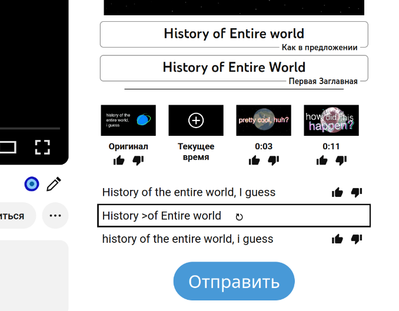

## Применение

«Кликбейт» уже давно является нормой на YouTube. Авторы делают вызывающие
обложки и называют видео так, чтобы как можно больше людей на них нажимало.
Порой совершенно не понятно что будет в видео по его заголовку. В то же время не
очень хочется тратить время на просмотр впустую.

DeArrow заменяет обложки на существующие кадры из видео, а также убирает из
заголовков лишние символы и заглавные буквы. Пользователи могут предлагать свои
заголовки видео, которые будут кратко содержать суть видео без лишних эмоций,
при этом сохраняя интерес к просмотру. Поведение расширения можно полностью
настроить под свои нужды.

## Установка

### Браузер

Официальное расширение DeArrow доступно для браузеров [Chromium], [Firefox]
и [Safari]. Оно работает на сайте YouTube и в мобильной версии.

[Chromium]: https://chromewebstore.google.com/detail/dearrow-better-titles-and/enamippconapkdmgfgjchkhakpfinmaj
[Firefox]: https://addons.mozilla.org/firefox/addon/dearrow/
[Safari]: https://apps.apple.com/us/app/dearrow-for-youtube/id6451469297

Официальное расширение платное, но доступен пробный период. Купите ключ за
единоразовый платёж, чтобы поддержать разработчиков. Если вы не можете купить
ключ, то [запросите бесплатный доступ](https://dearrow.ajay.app/free) или
[сгенерируйте его](https://ashleygraves.eu/dearrow).

DeArrow может быть интегрирован в [сторонние приложения](/collections/youtube-apps)
благодаря [открытому API](https://wiki.sponsor.ajay.app/w/API_Docs/DeArrow): смотрите
[список сторонних реализаций](https://wiki.sponsor.ajay.app/w/DeArrow/Community).
Функциональность может значительно различаться: смотрите [таблицу сравнения](/tables/youtube-apps).

## Использование

По умолчанию DeArrow заменяет обложки и заголовки видео на те, что были
предложены пользователями. Когда сведения были изменены, можно навести на видео
и нажать на 🧿, чтобы показать оригинал. Поведение DeArrow можно изменить в
настройках, а также задать отдельное для каждой группы каналов.

### Обложки

Пользователи могут предлагать кадры из видео заместо привлекающей внимание
обложки. Если нет предложений, будет использован случайный кадр из видео (при
этом используется база данных [SponsorBlock] для исключения попадания в рекламу),
но вы можете выбрать использовать оригинальную обложку или чёрный экран. Если
автор проводит A/B-тест обложки, то DeArrow по умолчанию будет всегда показывать
первоначальный вариант.

[SponsorBlock]: /software/sponsorblock

### Заголовки

Пользователи могут предлагать собственные заголовки видео, которые лучше
описывают суть. Если нет предложений, то можно настроить DeArrow на автоматическое
форматирование, при котором будут убираться заглавные буквы и эмодзи. Также в
настройках можно отключить автоматический перевод заголовков видео.

### Обычный (казуальный) режим

Некоторым пользователям предложенные заголовки могут показаться скучными, когда
оригинальные описывают видео более остроумно и забавно. В таком случае можно
переключиться на [обычный (казуальный) режим].

[обычный (казуальный) режим]: https://wiki.sponsor.ajay.app/w/DeArrow/Casual_mode

Казуальный режим даёт возможность голосовать за оригинальные заголовки,
которые им нравятся, в следующих категориях: забавные, креативные, хитроумные,
информативные, прочие. Те, кто предпочитает не видеть скучные заголовки, могут
задать минимальное количество голосов (по умолчанию 1 в каждой категории), при
котором будет отображаться оригинальный заголовок.

## Краудсорсинг

Данные DeArrow формируются обычными пользователями. Вы тоже можете внести
свой вклад в официальном расширении или в любом поддерживаемом приложении, чтобы
помочь другим людям комфортно искать подходящие видео для просмотра.

[Данные](https://sponsor.ajay.app/database) распространяются по лицензии
[CC BY-NC-SA 4.0] и доступны для скачивания всем желающим. Возможно запустить
[свой сервер](https://github.com/mchangrh/sb-mirror).

[CC BY-NC-SA 4.0]: https://creativecommons.org/licenses/by-nc-sa/4.0/deed.ru

### Внести вклад

> [!important]
> Перед отправкой сведений [прочитайте руководство](https://wiki.sponsor.ajay.app/w/Creating_segments).
Если вы не уверены в корректности данных, то лучше не отправлять их.
Вы можете спросить знающих людей в чате [Discord](https://discord.gg/SponsorBlock)
или [Matrix](https://matrix.to/#/#sponsor:ajay.app).

Значок карандаша под проигрывателем открывает панель, где можно проголосовать за
понравившиеся варианты или предложить свои, а также ознакомиться с краткими
инструкциями.

Заголовок и обложка должны содержать достаточно информации для того, чтобы
зритель смог принять обоснованное решение, стоит ли выбирать это видео для
просмотра. Следует избегать излишних эмоций.

Чтобы отправить кадр видео в качестве обложки, остановите его на подходящем
моменте и нажмите «Текущий кадр» в меню внесения вклада. Если другие
пользователи уже предложили кадры, то вы можете проголосовать за понравившиеся
варианты или против не подходящих.

Не пишите каждое слово с заглавной буквы, но правильно оформляйте заглавие для
названий и аббревиатур. Слова, заглавие которых не нужно изменять, следует
начинать с `>` для игнорирования автоматического форматирования. Обратите
внимание, что существуют особые форматы наименования для сериалов, спидранов,
музыкальных и художественных произведений.

### Пользователи

При первоначальном использовании для вас генерируется приватный идентификатор
пользователя. Вы можете найти его в меню «Копия/Восстановление». Если вы хотите
восстановить свою статистику, сохраните этот идентификатор и вставьте его сюда
на другом устройстве. Не делитесь своим приватным идентификатором с другими
людьми.

Также имеется публичное имя пользователя. По умолчанию это случайный набор
символов, но вы можете задать своё. Имя пользователя отображается в
[списке лидеров](https://dearrow.ajay.app/stats/), кто внёс наибольший вклад.
