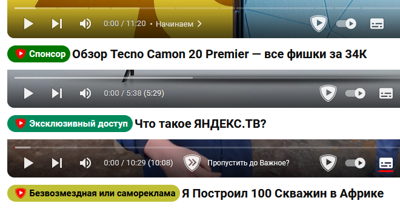
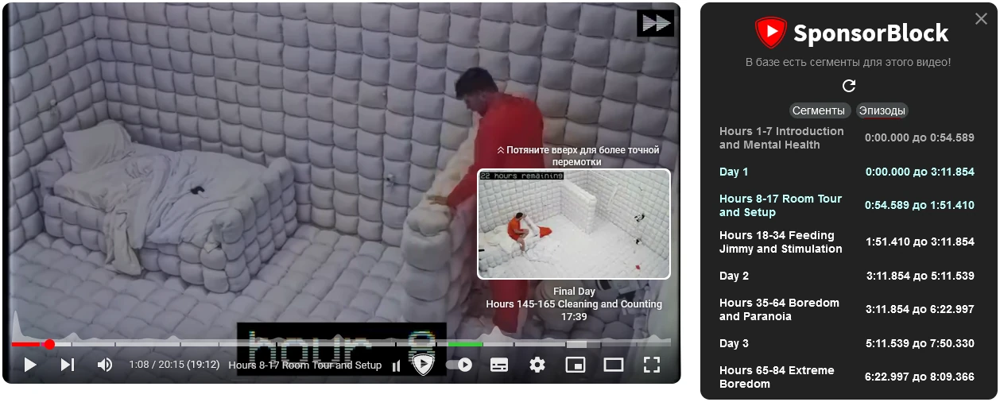
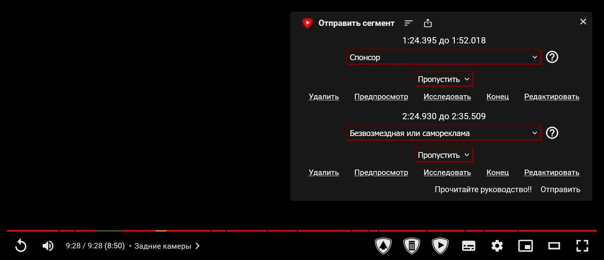

## Применение

Часто авторы видео на YouTube вставляют сегменты, которые не несут смысловой
нагрузки и лишь отнимают время. SponsorBlock предоставляет удобный способ быстро
пропускать это. Для этого необходимо, чтобы другой пользователь отправил
соответствующий отрезок времени. Затем у всех пользователей SponsorBlock сегмент
начнёт отображаться на шкале просмотра, и будет возможен автоматический или
ручной пропуск.

## Этичность

По умолчанию рекламные интеграции пропускаются автоматически. В теории это может
вредить авторам, так как отсутствие времени просмотра сегмента снижает статистику
для рекламодателя, из-за чего автор может получить меньшую прибыль. Но, *предположительно*,
рекламодатели платят за количество просмотров и переходы по партнёрским ссылкам,
ведь большинство людей пропускают рекламу вручную.

Встроенная реклама в видео не нарушает конфиденциальность пользователей, в
отличие от рекламы Google. По этой причине разработчики некоторых сторонних
приложений [рекомендуют](https://docs.freetubeapp.io/usage/sponsorblock/#disclaimer)
авторам использовать рекламные интеграции как более этичный способ заработка, а
пользователям — поддерживать авторов просмотром этих интеграций.

В любом случае встроенная реклама нередко оказывается навязчивой и опасной.
Поэтому вы вольны решать, стоит ли пропускать рекламу. SponsorBlock позволяет
отключить автоматический пропуск глобально или для определённых каналов. Помимо
рекламы возможно пропускать и другие раздражающие сегменты, такие как
напоминания о взаимодействии или заставки.

## Установка

Официальное расширение SponsorBlock доступно для браузеров [Chromium], [Firefox]
и [Safari]. Оно работает на официальном сайте YouTube и в мобильной версии. В
настройках можно включить сторонние сайты Invidious, CloudTube, Piped, YouTube Kids.

[Chromium]: https://chromewebstore.google.com/detail/sponsorblock-for-youtube/mnjggcdmjocbbbhaepdhchncahnbgone
[Firefox]: https://addons.mozilla.org/firefox/addon/sponsorblock/
[Safari]: https://github.com/ajayyy/SponsorBlock/wiki/Safari

SponsorBlock может быть интегрирован в [сторонние приложения](/collections/youtube-apps)
благодаря [открытому API](https://wiki.sponsor.ajay.app/w/API_Docs): смотрите
[список сторонних реализаций](https://github.com/ajayyy/SponsorBlock/wiki/3rd-Party-Ports).
Функциональность может значительно различаться: смотрите [таблицу сравнения](/tables/youtube-apps).

## Использование

В настройках вы можете изменить поведение пропуска и отображения сведений о
содержимом видео.

### Сегменты

Отображаются на шкале просмотра. При достижении пропускаются автоматически или
вручную в зависимости от настроек:

- Спонсор.
- Безвозмездная или самореклама.
- Напоминание о взаимодействии (подписка и т.п.).
- Пауза/начальная заставка («интро»).
- Конечная заставка/титры.
- Предпросмотр/краткое содержание (отрывки из видео в начале).
- Завязка/приветствие.
- Отвлечённые темы/шутки.
- Тишина в музыкальных видео.

Помимо этого можно отметить важный момент из видео: пропуск вступления,
переход к сути, ответ на вопрос, куплет песни. При загрузке видео предлагается
пропустить к этому моменту.

### Метки

Когда видео целиком было проспонсировано, то вы увидите соответствующую метку
на обложке и странице просмотра. Это особенно полезно при просмотре обзоров.

- **Спонсор**: автору заплатили за рекламу объекта во всём видео.
- **Эксклюзивный доступ**: автору предоставили объект бесплатно за создание видео про него.
- **Безвозмездная или самореклама**: автор представляет в видео свой продукт/проект или просто безвозмездно.

> [!warning]
> Эти метки устанавливают такие же пользователи, как и вы, поэтому информация
может быть недостоверной. Проверяйте перед отправкой, и не отправляйте, если не
уверены.

### Эпизоды

SponsorBlock также позволяет задавать эпизоды — собственные временные отметки
в случае, когда они не указаны автором. Помогает при просмотре больших видео и
записей трансляций. Внутри больших эпизодов могут быть маленькие.

Для отправки эпизодов требуется набрать некоторое количество репутации, из-за
этого они встречаются редко.

## Краудсорсинг

Данные SponsorBlock формируются обычными пользователями. Вы тоже можете внести
свой вклад в официальном расширении или в любом поддерживаемом приложении, чтобы
помочь другим людям комфортно смотреть видео без раздражающих сегментов.

[Данные](https://sponsor.ajay.app/database) распространяются по лицензии
[CC BY-NC-SA 4.0] и доступны для скачивания всем желающим. Возможно запустить
[свой сервер](https://github.com/mchangrh/sb-mirror).

[CC BY-NC-SA 4.0]: https://creativecommons.org/licenses/by-nc-sa/4.0/deed.ru

### Внести вклад

> [!important]
> Перед отправкой сегментов [прочитайте руководство](https://wiki.sponsor.ajay.app/w/Creating_segments).
Если вы не уверены в корректности сегмента, то лучше не отправлять его. Вы
можете спросить знающих людей в чате [Discord](https://discord.gg/SponsorBlock)
или [Matrix](https://matrix.to/#/#sponsor:ajay.app).

Значок с щитом и треугольником в проигрывателе начинает запись сегмента, после
чего можно выбрать категорию и отправить.

Постарайтесь отмечать границы сегментов с точностью до миллисекунды, чтобы
пропуск был максимально плавным для глаз и ушей. Используйте клавиши `,` и `.`,
чтобы перемещаться покадрово, и кнопку «Предпросмотр», чтобы посмотреть результат.

### Пользователи

При первоначальном использовании для вас генерируется приватный идентификатор
пользователя. Вы можете найти его в меню «Копия/Восстановление». Если вы хотите
восстановить свою статистику, сохраните этот идентификатор и вставьте его сюда
на другом устройстве. Не делитесь своим приватным идентификатором с другими
людьми.

Также имеется публичное имя пользователя. По умолчанию это случайный набор
символов, но вы можете задать своё. Имя пользователя отображается в
[списке лидеров](https://sponsor.ajay.app/stats), кто внёс наибольший вклад.

### Злоупотребление

Пользователи могут отправлять некорректные сегменты намеренно или случайно. На
самом деле это происходит очень редко. В таких случаях проголосуйте против и
исправьте несоответствия. В тяжёлых случаях можно пожаловаться в чат сообщества.
В качестве мер защиты также присутствует автоматическая блокировка.
[VIP](https://wiki.sponsor.ajay.app/w/VIP) имеют возможность модерировать
сегменты и других пользователей.
